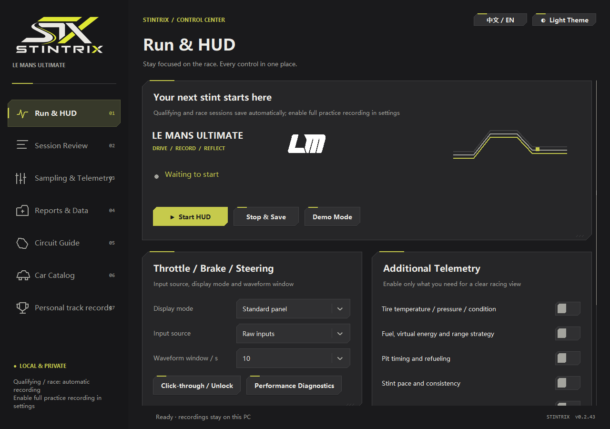
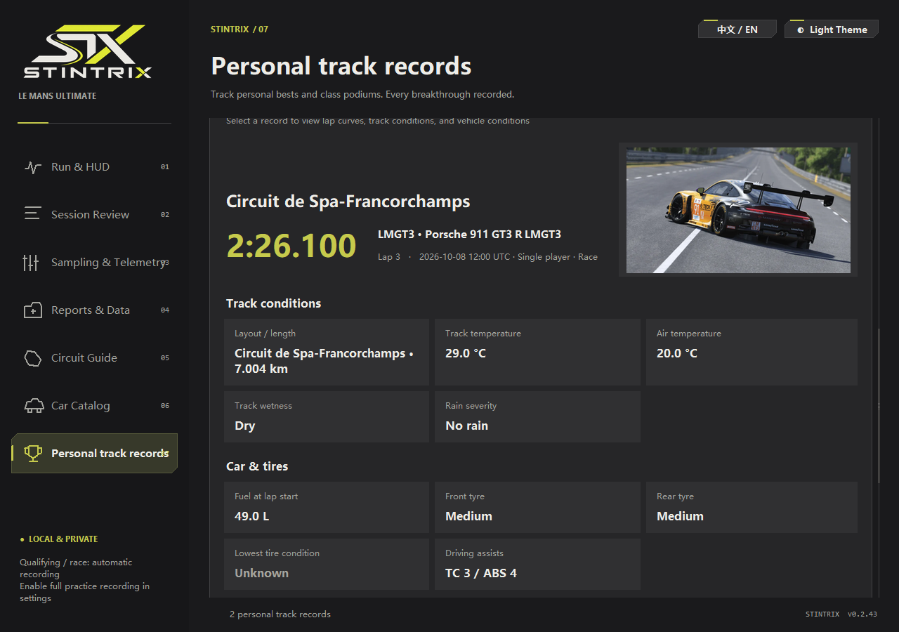
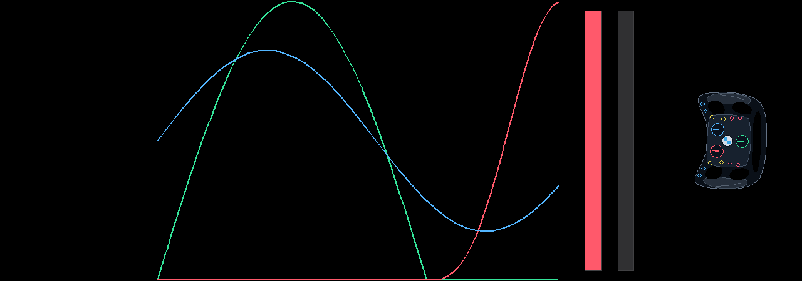
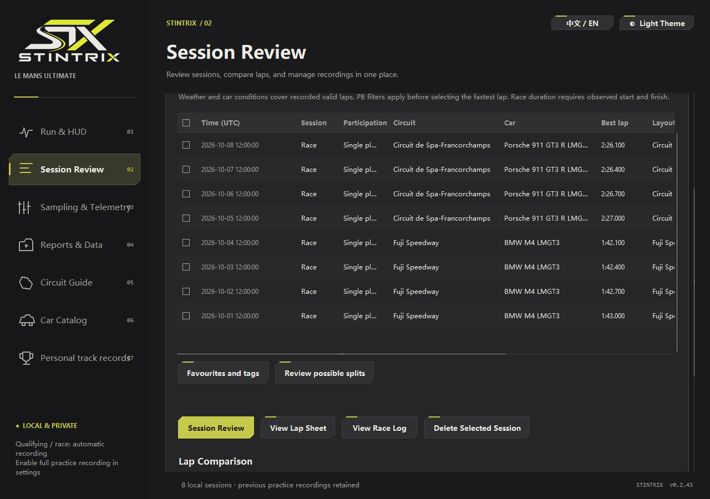

English | [简体中文](README.zh-CN.md)

<picture>
  <source media="(prefers-color-scheme: dark)" srcset="src/branding/stx-menu.png">
  
</picture>

# LMU Stintrix

A local telemetry HUD and lap analysis toolkit for **Le Mans Ultimate** and **Assetto Corsa EVO**.

Choose **LMU** or **AC EVO** in the control center. Both share the industrial interface, input HUD, shortcuts, recording and lossless archives; each simulator keeps its own sessions, settings and records. [Supported features and switching](docs/SIMULATORS.md)

See your inputs while driving. Compare braking, throttle application, and pace afterward. Keep a history of your progress.

[](https://github.com/MarkYang44/LMU-Stintrix/releases/latest)

[](LICENSE)

**[Download Windows x64 · v0.3.52](https://github.com/MarkYang44/LMU-Stintrix/releases/download/v0.3.52/LMU-Stintrix-v0.3.52-windows-x64.zip)** · [Release notes / other versions](https://github.com/MarkYang44/LMU-Stintrix/releases/latest) · [Quick start](#quick-start) · [Documentation](#documentation)

## Overview

Stintrix brings live driving feedback, automatic recording, and post-session analysis into one desktop app. Review complete laps from the same layout, compare your inputs and lap times, then revisit personal records as you practice.

It reads the selected game's shared memory without DLL injection or game-file changes. English and Simplified Chinese menus, dark and light themes, and local reports are included. Your recordings stay on your computer. Available analysis depends on the simulator and recorded channels.

## Screenshots

Real LMU windows captured from v0.2.43, using generated sample sessions and the built-in DEMO, not actual driving results. The current interface includes a game selector and further workflow improvements. The clean HUD uses language-neutral graphics. [Capture details](docs/screenshots/README.md).

<table>
  <tr>
    <td width="50%"><strong>Control center</strong><br><a href="docs/screenshots/en/control-center.webp"></a></td>
    <td width="50%"><strong>Personal bests and conditions</strong><br><a href="docs/screenshots/en/personal-best.webp"></a></td>
  </tr>
  <tr>
    <td><strong>Live input HUD</strong><br><a href="docs/screenshots/en/input-hud.webp"></a></td>
    <td><strong>Session library</strong><br><a href="docs/screenshots/en/session-library.webp"></a></td>
  </tr>
</table>

## Core features

### See your inputs on track

- Live throttle, brake, and steering traces: raw / game-filtered inputs in LMU, distinct physics / HUD inputs in EVO.
- Compact layouts, saved HUD positions, silent recording, and global shortcuts. LMU also provides optional tire, fuel, Virtual Energy, pit, stint, and weather panels.
- EVO adds a compact gear / RPM strip with game-reported shift and limiter hints, plus ABS / TC / ESC activity lamps and timeline marks. Toggle each in Run & HUD or the HUD menu; display choices do not interrupt recording. New native fields are saved with every captured sample, independently of the selected input channel.
- Lap validity follows game evidence. EVO saves its two native validity flags separately and favors an explicit valid signal when they disagree. Unresolved or historical combined signals remain pending; capture gaps and pit visits affect statistical eligibility, without being presented as game penalties.

### Keep sessions ready for review

- Automatic qualifying / timed-session and race recording; practice recording is optional, including EVO free roam.
- Lossless telemetry storage, CSV export, searchable sessions, and ZIP / 7z session packages.
- Background reports with per-step status and failed-task retry; EVO defers report generation and compression until capture stops.
- Batch online / offline corrections keep original recordings intact; source folders and selection actions are available from the session menu.

### Understand lap differences

- Compare valid complete laps from the same track layout, within or across sessions.
- LMU provides distance-aligned inputs, speed, time differences, and recorded trajectories. EVO provides complete recorded input curves and game-reported lap-time differences, with zoom, pan, and original sample readouts.
- Compare saved session bests directly, with 2–6 EVO sessions on the same layout. Selecting 3–6 EVO sessions makes this the main comparison action. Reopen A/B with your previous track, sessions, and valid-lap choices; both simulators keep this context separate and recheck current lap availability. EVO also has a separate action to reopen the last multi-lap page generated during the current app session.
- EVO's lap overview shows valid-lap counts, best, median and variation, with single-lap curves, A/B and 3–6-lap overlays. Select one usable lap to compare it with the session best, even when that best lap is filtered out. Selected usable laps show their observed mean, best, slowest and variation, without condition correction. Mixed selections offer **Keep selected usable laps** before comparison or export. Export up to six full-telemetry CSVs, or export the current filtered and sorted lap-time list. Open it from personal records/history; double-click or Enter activates selected laps. The optional rhythm chart locates its source lap, and consecutive-run actions preview and select the fastest 3- or 5-lap window without bridging gaps.

### Give practice a focus

- In LMU, training priorities and saved practice targets based on recorded laps.
- In EVO, **Lap overview → Practice tools** sets a lap-time target for the current window, or uses the selected valid lap's original time as that target, and counts usable laps meeting it in the filtered list and selection. Select filtered laps meeting or exceeding the target in one action, then compare or export them; no condition correction is applied. **Export selected lap times** exports any number of selected lap facts, retaining invalid and unknown states, without full telemetry.
- EVO's lap rhythm chart can show the current target as a dashed line, with the signed difference on hover. Missing and invalid laps remain gaps; clearing the target restores the ordinary chart. The rhythm chart and LMU history chart support arrow-key browsing, Home/End and Enter selection. EVO chart mode hides the bottom actions and restores them when returning to the table.
- Race review keeps eight filters: track, vehicle class, model, phase, race mode, time range, result and favorites. Search, sorting and saved views remain available. Both games offer a red **Delete selected records** toolbar action, with confirmation of the selected complete sessions before deletion.
- Progress analysis that considers car, fuel, tires, weather, and available conditions.

### Follow your records

- Personal bests and record history for both simulators: LMU by layout and vehicle class, EVO by layout and specific model.
- EVO record details show available facts, without unknown placeholders or repeated model names. Car and track photos sit side by side on wide windows and stack on narrow ones; input curves follow below.
- Lap sheets, race journals, and locally exported achievement cards. LMU also supports confirmed class podiums and read-only game-result XML integration.
- EVO car galleries filter by brand and category, with two-car comparison that keeps your selections and browsing position. Track cards show verified layouts and available official circuit maps. Artwork downloads are optional and stay local.

### Review video inputs · Experimental

- In LMU, estimated throttle and brake traces from a calibrated local video, with optional historical-lap comparison.
- Results stay separate from native records. Local FFmpeg is required; see [Video analysis](docs/VIDEO_ANALYSIS.md).

## Installation

1. [Download the Windows x64 ZIP](https://github.com/MarkYang44/LMU-Stintrix/releases/download/v0.3.52/LMU-Stintrix-v0.3.52-windows-x64.zip), or browse [other releases](https://github.com/MarkYang44/LMU-Stintrix/releases/latest).
2. Extract the entire archive into a writable folder.
3. Run **`LMU-Stintrix.exe`**.

No Python installation is required. Keep `_internal` beside the EXE; relocate the whole folder together. Preserve `data/` and your settings when updating.

<details>
<summary>Run from source</summary>

Use **Code → Download ZIP**, or clone the repository. Extract it, run `Setup.cmd`, then `Start.cmd`.

Source setup uses **Python 3.13 x64 with Tcl/Tk**. The script can install it through winget and prepares a local environment with pinned dependencies. Initial setup needs internet access. Configuration and troubleshooting: [Usage](docs/USAGE.md).

</details>

## Quick start

1. Open Stintrix and select **LMU** or **AC EVO** at the top left. For LMU, enable **Settings → Gameplay → Enable Plugins** in the game.
2. Click **Start Recording**. Use **中文 / EN** to switch menu language.
3. Enter the track in windowed or borderless mode.
4. Drive a qualifying / timed session or race; recording starts automatically when supported driving data arrives. Practice recording is off by default; enable it under **Sampling & Telemetry** if needed.
5. Afterward, open **Session Review** to inspect the recording or compare laps.

Use **Stop & Save** to hide the HUD and finish saving in the background. Switching games safely closes the current HUD and waits for pending work before opening the selected mode. Try **Demo Mode** or `Demo.cmd` to explore the LMU interface without connecting to a game.

## Compatibility and data sources

- **Target platform:** Windows 10 / 11 x64. Builds and validation use Windows x64 with Python 3.13; the selected game must also meet its own system requirements.
- **LMU live data:** native `LMU_Data` shared memory through the bundled [pyLMUSharedMemory SDK](THIRD_PARTY_NOTICES.md#pylmusharedmemory).
- **EVO live data:** read-only `Local\acevo_pmf_*` shared memory. Physics and HUD channels remain distinct; unavailable clocks, conditions, and results remain blank.
- **Saved data:** separate Stintrix libraries and archives for each game. Native `.duckdb` and game-result XML import are LMU features; archives from the other game require switching modes first.
- **Availability:** channels depend on the game / SDK and recording source. Position replay needs recorded coordinates; exclusive fullscreen may hide the desktop HUD.

EVO personal records and A/B comparison require observed valid complete laps with game-reported timing. Older recordings without that evidence remain readable but do not become verified lap records. **More actions → Manage Recordings** opens the shared full library for layout searches, notes, archives and verified-lap selection. Report tasks can open directly on the selected sessions and keep the report browser's filters. EVO supports direct CSV export of session bests or the valid laps selected in A/B. Condition-based training, live reference laps, official results, and additional vehicle panels remain LMU features. [Detailed scope](docs/SIMULATORS.md).

Lap-sheet and journal images can use the built-in compatible generator. Personal achievement cards use the selected game's branding and matching artwork; EVO shows recorded lap facts in place of unavailable LMU conditions. Reusing the original RaceCom engine requires your own local installation; it is not bundled. Optional EVO artwork is downloaded from official game or circuit-operator sources and is not redistributed in releases. [Credits and sources](THIRD_PARTY_NOTICES.md#evo-official-artwork-and-svg-rendering).

## Project status

Under active development. EVO shared-memory fixtures, storage round trips, and UI workflows have been checked; acceptance against an installed game during live driving remains pending. Video extraction is experimental and produces estimates. See [release notes](docs/RELEASE_NOTES.md) for changes and [Releases](https://github.com/MarkYang44/LMU-Stintrix/releases) for packaged versions.

## Privacy

Telemetry stays on your computer, reports are generated locally, and there is no automatic telemetry upload. Exports can contain driver names and dates; review them before sharing. [Privacy and migration](docs/PRIVACY.md).

## Documentation

Detailed guides are currently primarily in Chinese.

| Document | What it covers |
| --- | --- |
| [Usage](docs/USAGE.md) | HUD operation, recording, review, and troubleshooting |
| [LMU and AC EVO](docs/SIMULATORS.md) | Switching games, supported features, separate data, and EVO setup |
| [Architecture](docs/ARCHITECTURE.md) | Module responsibilities and development boundaries |
| [Performance](docs/PERFORMANCE.md) | Measured results, workloads, and tradeoffs |
| [Storage](docs/STORAGE_OPTIMIZATION.md) | Lossless storage, CSV recovery, and archives |
| [Data processing](docs/DATA_PROCESSING.md) | Shared analysis, training reuse, measured timings, and precision guarantees |
| [Video analysis](docs/VIDEO_ANALYSIS.md) | Calibration, tools, comparisons, and accuracy limits |
| [Privacy](docs/PRIVACY.md) | Local data, sharing, and migration |

## Development

Use **Python 3.13 x64 on Windows**, including Tcl/Tk. From a configured checkout:

```powershell
.\Setup.cmd -BuildTools
.venv\Scripts\python.exe tools/run_tests.py
.venv\Scripts\python.exe tools/build.py --no-checksums
```

Maintenance and validation: [Architecture](docs/ARCHITECTURE.md) · [Release workflow](docs/RELEASE.md).

Daily validation selects a small smoke set and checks related to pending changes. Use `--plan` to inspect the scope, `--tests <case>` for a precise check, and `--full` only when the complete historical suite is needed. See [Testing policy](docs/TESTING.md). Build the portable ZIP when preparing a release.

## License and credits

[MIT](LICENSE). Third-party code and artwork: [Third-party notices](THIRD_PARTY_NOTICES.md).

An independent community project, not affiliated with or endorsed by Studio 397, Motorsport Games, KUNOS Simulazioni, or 505 Games. Le Mans Ultimate, Assetto Corsa EVO, and other referenced names belong to their respective owners.
