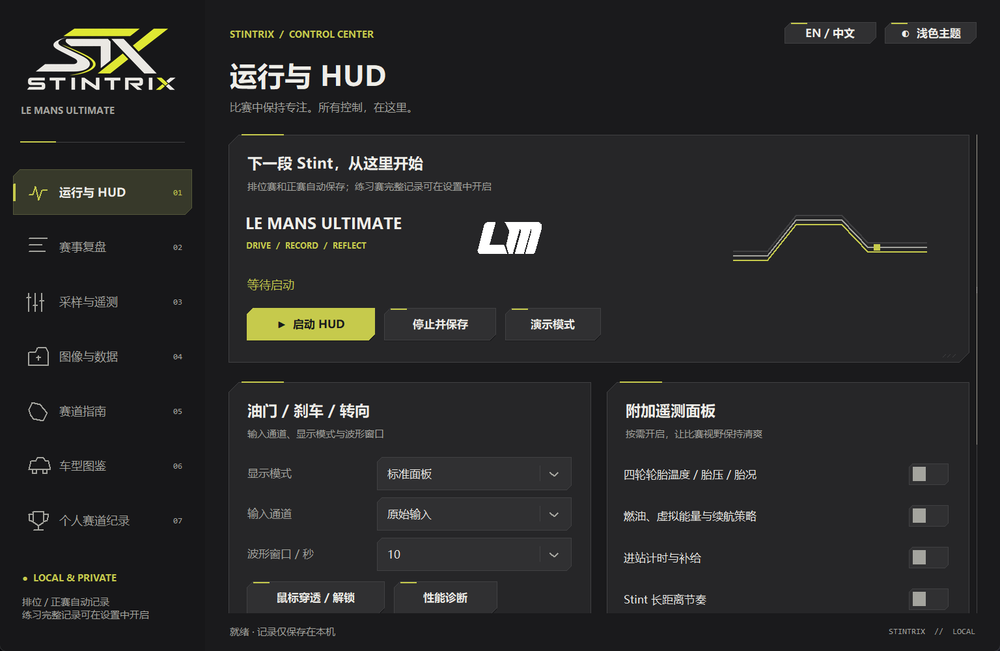
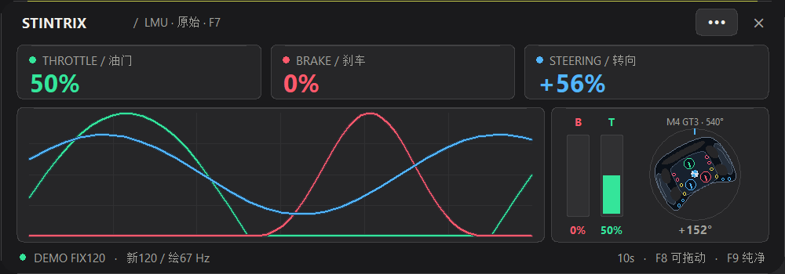
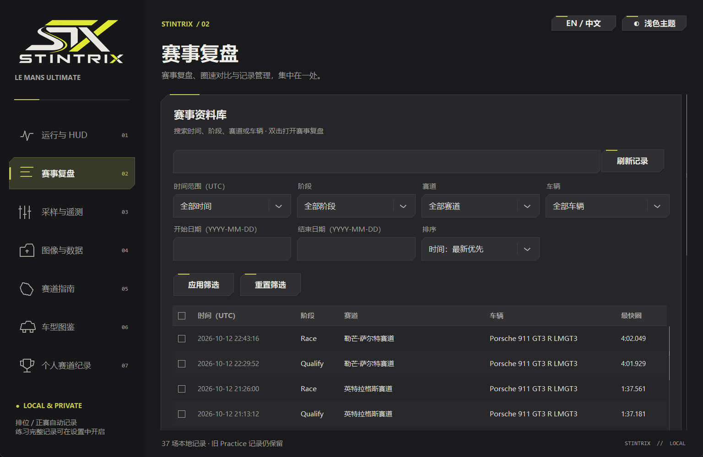
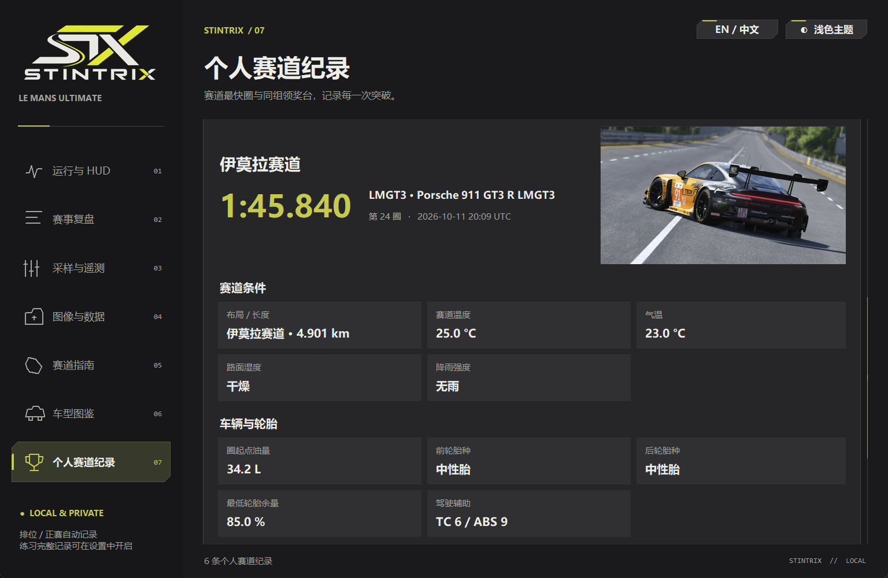
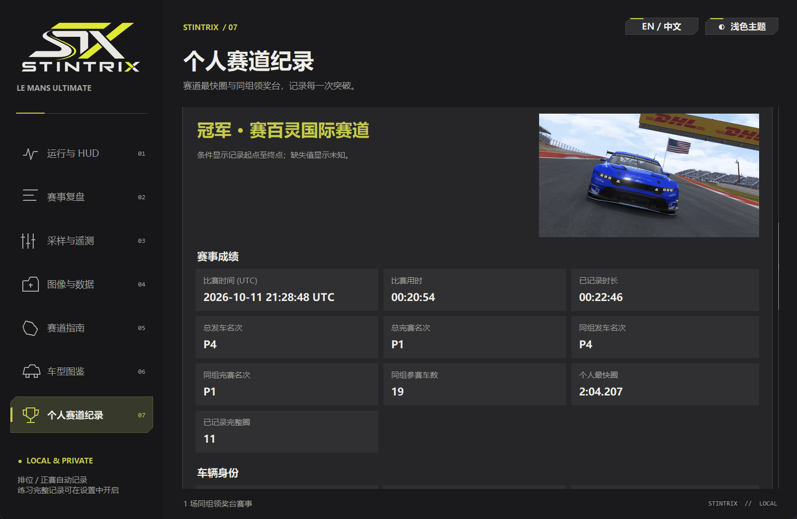
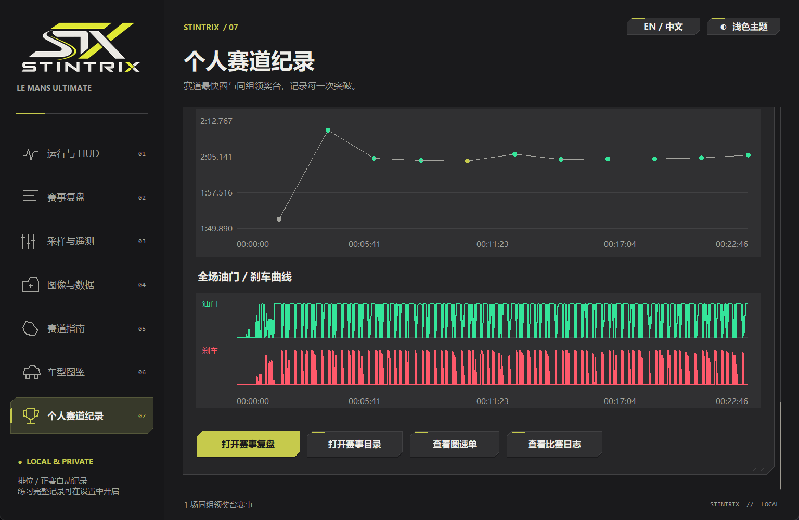
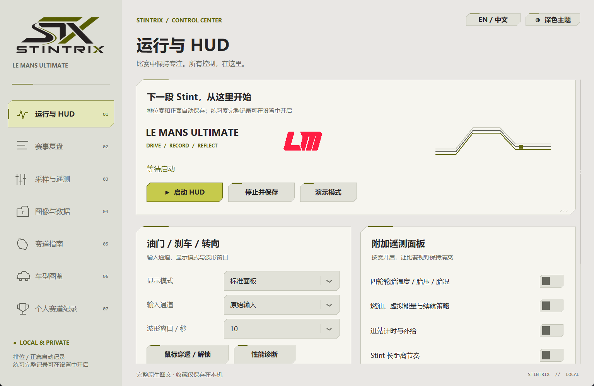
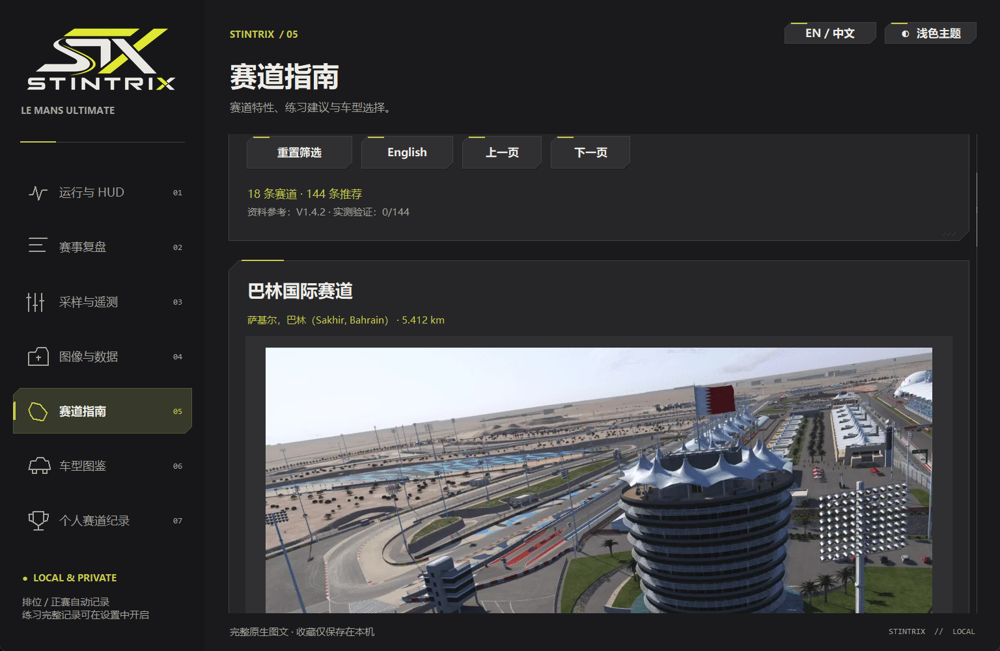

# LMU Stintrix

v0.2.40：新增无损分块列式存储，按块 / 按列读取完整采样；可恢复普通 CSV 或独立导出。可重建缓存按容量整理，本地报告复用资源，同圈 CSV 与未变化的归档复用已有输出；赛事数据不计算内容哈希、不在导出后完整回读校验。旧记录继续兼容。详见 [存储优化与恢复说明](docs/STORAGE_OPTIMIZATION.md)。

Local telemetry HUD, recorder and lap analysis for **Le Mans Ultimate** on Windows x64.

实时油门 / 刹车 / 转向 HUD、比赛记录、完整圈对比与耐力赛遥测分析。界面支持中文 / English，所有记录默认保存在本机。

控制中心提供 **深色 / 浅色** 两套工业风主题：炭黑或暖灰白底色、黄绿强调色、切角面板。右上角一键切换并保存在本机；赛事列表支持像素平滑滚动、选择过渡及键盘操作。应用图标沿用 GTD 菜单图标。

实时缓存与离线复盘采用紧凑数值存储和流式压缩；保留完整采样、原始 CSV 与现有操作。实测结果、模块职责和旧网页升级方式见 [内存与赛事文件](docs/PERFORMANCE.md)。



*Windows 实机运行：集中配置 HUD、遥测面板和记录选项。下方展示赛事复盘、个人最快圈与同组领奖台的实际界面。*

## 下载与一键启动

**便携版（推荐）**：从 [Releases](https://github.com/MarkYang44/LMU-Stintrix/releases) 下载 `LMU-Stintrix-v*-windows-x64.zip`，完整解压到可写目录，双击 **`LMU-Stintrix.exe`**。不需要安装 Python；`Demo.cmd` 可在不开游戏时演示。不要只移动 EXE，保留 `_internal` 文件夹。

**源码版**：点击 GitHub **Code → Download ZIP**，完整解压，双击 `Setup.cmd`，完成后双击 `Start.cmd`。首次配置需要联网：脚本查找 64 位 Python 3.13；没有时使用 winget 为当前用户安装官方 Python，然后创建独立 `.venv`、校验固定版本依赖并安装，同时下载校验约 0.6 MB 的官方 7zr 工具。没有 winget 时，请手动安装带 Tcl/Tk 的 [Python 3.13](https://www.python.org/downloads/windows/)，然后重试。

`LMU-Stintrix.exe` 默认打开分类控制中心（源码启动脚本同样适用），点击 **启动 HUD** 后读取 LMU 的 `LMU_Data` 共享内存。**排位赛和正赛自动记录；可在采样与遥测中开启练习赛完整记录，默认关闭。Warmup 仅显示实时 HUD。** 无需向游戏复制 DLL，也不修改游戏文件或现有 ApexLink / RaceCom 配置。LMU Stintrix 独立运行；不是 RaceCom 本体、ApexLink 或官方插件。

## 实机截图

以下截图采集于 Windows 上运行的 **v0.2.21**。赛事列表、最快圈和领奖台页面使用真实历史赛事；HUD 截图使用程序自带 **DEMO 合成输入**，可在不开游戏时体验。车型照片来自内置车型图鉴，涂装可能与当场赛事不同。

### 输入 HUD：油门、刹车与转向

三色曲线、实时输入百分比、踏板柱和示意方向盘集中展示；底部同时显示实际采样与绘制速率。



### 赛事资料库：组合筛选与排序

按 UTC 日期范围、阶段、赛道和车辆查找历史赛事，支持升降序排序；圈速与所用车辆直接显示在列表中。



### 个人最快圈：圈速、车型与条件

真实伊莫拉纪录 **1:45.840**：对应车型图片、赛道布局、温度、圈起点油量、轮胎和驾驶辅助分区呈现。不同赛道布局与车辆组别独立统计。



### 同组领奖台：保留每场比赛的成绩

真实赛百灵同组冠军示例：从 **同组 P4** 发车，**同组 P1** 完赛，个人最快圈 **2:04.207**。总排名、同组排名与比赛用时分开展示。



继续向下可查看圈速随时间的变化及整场油门 / 刹车曲线，并直接打开赛事复盘、圈速单和比赛日志。



### 浅色主题与赛道指南

深浅主题一键切换，HUD 与记录管理仍沿用同一套操作。



赛道指南在菜单内展示赛道图片、资料与车型建议，支持筛选、收藏和翻页。



## 训练与个人成就

在 **个人赛道纪录 → 赛道最快圈** 选择纪录，下方可打开 **训练优先级报告** 或 **生成个人战绩卡**。

- **训练优先级报告**：汇总相同赛道布局、同车型、条件接近的已验证完整圈，至少需要 4 圈。使用实际最快圈作为参考，按典型时间差和波动排序；可查看制动点、最低速度、全油门恢复差并导出离线 HTML。条件缺失会明确标注，不把排序分数当作保证提升的秒数。
- **个人战绩卡**：最快圈和同组领奖台均可生成 1920 × 1080 PNG，包含对应车型照片、成绩和关键条件。提供实时预览，默认隐藏姓名与日期，可在生成前开启。图片只保存到本机数据目录的 `PersonalRecords/AchievementCards`，不会自动上传。
- **纪录履历**：与赛道最快圈、同组领奖台并列，按赛事时间显示首次观测及每次刷新纪录的日期、车型、圈号和提升用时。支持赛道 / 车辆 / 布局筛选与分类，默认最新优先；每个布局、车型分别统计并展示可点击的提升折线图。从每场已保存的最快圈重建，无法还原未保存的逐圈刷新历史。重复导入去重，缺失日期和冲突副本不参与排序。

Training reports, local achievement cards, and session-best record histories are available under Personal track records. Analysis uses recorded valid laps and labels unknown conditions. Card exports hide driver names and dates by default and remain local.

参赛方式支持 **单人 / 线上 / 未知** 标记、筛选与排序，覆盖赛事复盘和个人纪录各标签。车库、进站或暂停保留同场记录；历史模式根据匹配的游戏结果补充，缺失证据不猜测。

## 战绩与训练分析

- **官方战绩**：在“个人赛道纪录 → 官方战绩”同步游戏结果 XML。多人赛事按车手姓名识别，同组前三补充领奖台；只有 XML 的旧赛事展示成绩和圈计时，不补造遥测。
- **训练报告 2.0**：从最快圈详情打开，选择实测轨迹上的分析区间，编辑起点 / 弯心 / 终点，比较滑行及 ABS/TC 活动；没有坐标时显示距离分段。
- **同条件进步分析**：同布局、车型和车手，以圈起点油量、天气、胎种与辅助设置筛选；展示中位数、最快圈和波动，标明样本数量及未知条件。
- **数据接口检查**：在“采样与遥测”查看 SDK 接口声明和更新状态；等待连接、陈旧数据与结构异常分开提示，导出诊断到本机。

分析缓存以路径、大小和修改时间更新；XML 流式读取，曲线按赛事加载，不新增文件哈希校验。具体用法与数据边界见 [使用说明](docs/USAGE.md)。

## 功能

- 三色输入波形：油门绿、刹车红、转向蓝；原始输入 / 游戏过滤后输入自由切换。
- 紧凑置顶 HUD、纯曲线和纯曲线 + 柱形图 / 540° 示意方向盘模式；缩放与磨砂风格显示。
- 1–4000 Hz 目标轮询频率、动态采样、同步绘制及实际速率诊断。游戏新数据频率、CPU、Tk 和屏幕刷新率决定实际效果；高轮询不会制造新的游戏遥测。
- 结束后自动保存 CSV、离线 HTML 回放、最快圈文件及油刹曲线图；最快圈带圈号、车辆、赛道和会话信息。
- 分类控制中心：启动与 HUD、赛事复盘、采样与遥测、图像与数据；赛事复盘共用一个列表，直接打开图片、Review、完整圈 A / B 和跨场最快圈对比。
- 赛后调用用户自行配置的 RaceCom **Image Generate.exe**，使用原版浅色版式生成 `圈速单.png`、`比赛日志.png`，保存在同一赛事目录。生成器及其 `Source` 图片需保留在自己的安装目录；在控制中心 **图像与数据** 选择生成器。公开下载包不包含第三方程序或照片。
- 原版生成器未配置时保留遥测并提示配置；也可明确选择 `native` 兼容版式（长比赛分页）。演示模式默认使用兼容版式。旧记录可从菜单补图，切换生成方式会保留旧报告备份。缺失字段不补造；PIT / 部分记录 / 未验证圈标为统计无效，仅排除最快圈计算，不代表游戏处罚。
- 圈 A / 圈 B 可各自选择任意赛事的任意有效完整圈，支持不同车型；必须同赛道同布局。布局名与实测长度联合校验（长度差不超过 1 m），旧圈缺少有效性标记时不列入选择器。旧的完整圈提取入口继续保留。同车跨比赛 HUD 参考圈、距离对齐与驾驶建议继续可用。
- 左侧 **个人赛道纪录** 按赛道、布局、车辆组别统计有效最快圈，展示车型、用时、油刹曲线、圈起点油量、前后轮胎、温度、湿度、雨强和车辆条件，并可打开完整圈分析。演示与未验证旧圈不参与个人纪录。缺失条件显示未知；旧记录只在车型名称或预置目录能够确认组别时归类，否则独立列为未知车型。
- 中文菜单显示中文赛道名，赛事列表、圈选择器、个人纪录、赛道指南与记录管理均支持；英文模式保留原名，中英文均可搜索。纪录详情采用大号圈速、独立赛道条件与车辆条件分区，轮胎摘要只展示前后胎种及最低轮胎余量；详细原始遥测仍保留。
- 新旧记录的 `GT3 / LMGT3` 等组别别名统一统计，保留同布局同组别真正最快圈。
- 历史比赛日志保留原样；新记录在原“发车”和“完赛”卡片显示 `P32 / 同组 P14`，同组数据缺失时标注未知。
- **个人赛道纪录 → 同组领奖台** 与最快圈页面并列，按冠军 / 亚军 / 季军查看已确认同组完赛前三的正赛；展示成绩、车队、车型组别、赛道与车辆条件及整场圈速 / 油刹曲线。退赛、取消资格、演示和未知同组结果不计入；历史赛事不改写，同一比赛包的重复导入只统计一次。
- 赛道轨迹播放、位置对比、缩放和拖拽；胎温 / 胎压 / 磨损、燃油 / 能量及耐力赛相关面板与日志分析。部分通道需要导入原生遥测文件。
- 只读导入 LMU `.duckdb` 记录、会话库、恢复与压缩。不会上传遥测，也不会连接外部 AI 服务。
- 会话库支持多选导出 / 导入比赛包：每场可选 ZIP 或 7z，保留完整遥测、离线复盘、圈文件和备注，可手动上传网盘。菜单默认快速导入，完整 SHA-256 校验可选；旧 ZIP 继续兼容。
- 新记录文件夹、比赛包与会话库带 `Qualify / Race` 阶段标签；旧 Practice 记录保留且无需改名。

游戏 HUD 建议使用窗口 / 无边框窗口模式。它是 Windows 置顶窗口；独占全屏可能不显示。HUD 标题栏菜单按钮打开控制中心，右键快捷菜单继续保留；拖动移动。快捷键与工作流见 [使用说明](docs/USAGE.md)。

## 数据与隐私

默认输出在 `data/`；机器配置在 `local_settings.json`。比赛记录包含驾驶员姓名、日期、车辆、圈速等个人信息，报告也会嵌入这些内容。默认配置仅存在本机，不会提交到 Git。详见 [隐私与迁移](docs/PRIVACY.md)。

公开版的预置底图库为空：此前本地参考图没有足够明确的再分发授权，因此未随项目发布。**有世界坐标或 GPS 的记录直接绘制实测赛道轨迹，位置回放、对比和缩放仍可使用。** 缺少坐标的旧记录会提示不可用，不会猜测车辆位置。

已有 InputScope 用户可以用 `tools/migrate_inputscope.py` 迁移记录、使用偏好和私有底图库；原文件保留，数据不会加入 Git 或发布包。具体见 [隐私与迁移](docs/PRIVACY.md)。`Start Clean.cmd`、`Start Clean Controls.cmd`、`Start Demo.cmd` 继续提供旧版相同的启动方式。

## 开发与发布

开发测试集中在 `tests/`，自检、构建与发布工具集中在 `tools/`；根目录只保留日常启动与源码安装入口。便携 ZIP 不包含这些开发文件或开发文档，保留原有各个启动模式、操作说明和必要许可证。

双击 `tools/Build.cmd` 安装固定构建依赖并生成 `dist/LMU-Stintrix-v*-windows-x64.zip` 和 SHA256 文件。源码无需商业运行包，SDK 的 MIT 源码已包含。Python 3.13 x64 是当前验证的构建环境。

```powershell
.venv\Scripts\python.exe tools/run_tests.py
.venv\Scripts\python.exe tools/audit_publication.py
```

Windows CI 检查公开文件、运行隔离测试并构建便携 ZIP；推送与 VERSION 一致的 `v*` 标签，在全部验证通过后自动发布带 ZIP 和 SHA256 附件的 **公开 Release**。发布步骤见 [维护说明](docs/RELEASE.md)。

## English quick start

Download and extract the portable Windows x64 release, then double-click **LMU-Stintrix.exe**. For source ZIPs, run **Setup.cmd** first; it provisions Python 3.13 and verified dependencies. **Demo.cmd** uses synthetic telemetry only. No files are installed in the game directory. All racing data stays in `data/` locally. Use the EN / 中文 switch at the top of the control center to select English or Chinese. Read-only LMU shared memory is supplied by the bundled MIT-licensed SDK.

This is an independent community project, not affiliated with Studio 397, Motorsport Games, Fanatec or BMW. The schematic steering wheel uses original drawing code; no commercial artwork is included. Project source: MIT; upstream notices: [THIRD_PARTY_NOTICES.md](THIRD_PARTY_NOTICES.md).

赛道指南与车型图鉴：完整图文直接显示在控制中心菜单，支持 18 条赛道、24 台车型、144 条推荐、42 张官方来源图片、收藏与 2–3 项原生对比。单列宽松卡片，每页 3 条；推荐按需展开，图片滚出视野后释放。深浅终末地主题和中英切换均保留，无需浏览器或服务器。收藏与语言仅保存到本地 `data/guide_settings.json`。

## Windows 快捷启动与表单操作

控制中心 **运行与 HUD → Windows 快捷启动 → 添加 / 更新开始菜单** 会创建当前用户的 `LMU Stintrix` 快捷方式。程序会核验 Windows 应用目录，确认识别后可在 Windows 搜索中输入 `Stintrix` 或 `LMU`，也可从开始菜单的所有应用启动；无需管理员权限。可右键搜索结果固定到开始菜单或任务栏。移动便携文件夹后，重新打开 EXE 点击更新入口即可；移除入口不会删除程序或个人数据。首次解压仍需保留完整 `_internal` 文件夹。

表单使用统一的切角输入框与下拉面板：黄绿焦点描边、短展开过渡、平滑选项高亮，兼容深浅主题。下拉框支持方向键、Home / End、输入前缀跳转、Enter 确认、Escape 取消和 Tab 切换；长列表可滚动。动画仅在交互时运行，离开页面会清理弹层与回调。

已启用的入口在新版启动时会按当前登录用户检查并修复；检查在后台进行。若显示“Windows 尚未列出应用”，可稍后再次点击更新。入口识别状态保存在本机 `data/desktop_registration.json`，不参与发布。

控制中心顶部 **EN / 中文** 可切换整个菜单语言，重启后保留；主题和语言分别保存到本机 `data/interface_settings.json`。赛道指南与车型图鉴随菜单语言切换，赛事记录、配置值和文件名不因语言切换而改变。
