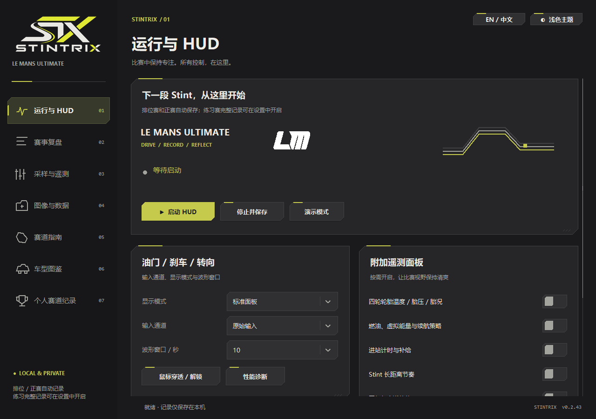
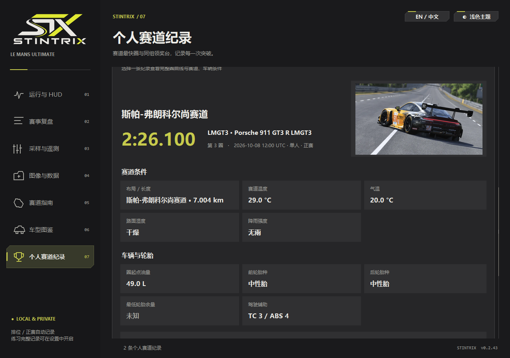
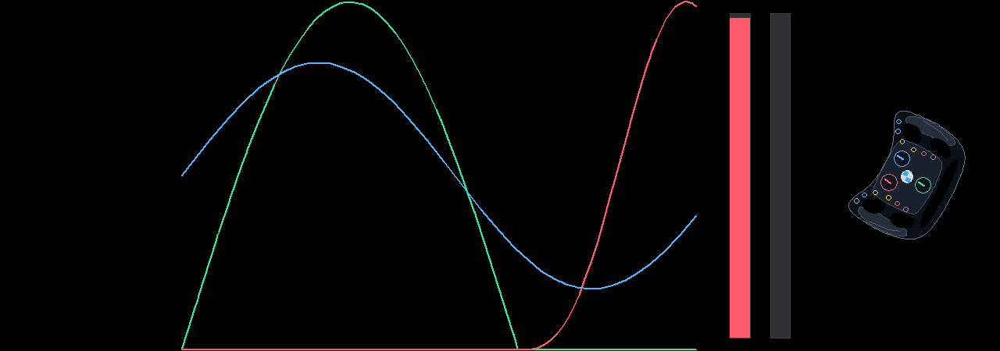
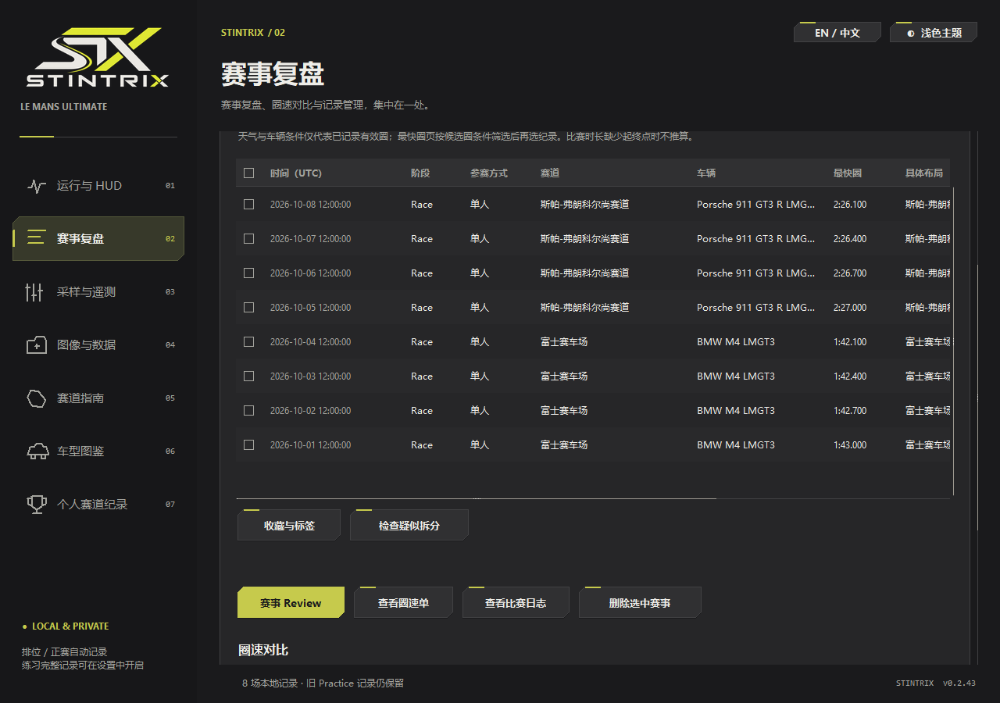

[English](README.md) | 简体中文

<picture>
  <source media="(prefers-color-scheme: dark)" srcset="src/branding/stx-menu.png">
  
</picture>

# LMU Stintrix

面向 **Le Mans Ultimate** 的本地遥测 HUD 与圈速分析工具。

驾驶时看清油刹与转向，赛后比较制动、给油与圈速变化，持续记录自己的进步。

[](https://github.com/MarkYang44/LMU-Stintrix/releases/latest)

[](LICENSE)

**[下载 Windows x64 版](https://github.com/MarkYang44/LMU-Stintrix/releases/latest)** · [快速开始](#快速开始) · [使用文档](#使用文档)

## 项目简介

Stintrix 把实时输入反馈、自动记录和赛后分析放在同一个桌面应用里。按赛道距离对齐完整圈，查看油刹、速度与用时的差异，再结合个人纪录回顾练习效果。

程序直接读取 LMU 原生共享内存，不注入 DLL、不修改游戏文件。菜单支持简体中文和 English，可切换深浅主题；记录与报告默认保存在本机。

## 界面预览

以下为当前源码版本的真实程序窗口，使用生成的示例赛事与内置 DEMO，不代表真实驾驶成绩。纯净 HUD 采用无语言文字的图形显示。[截图来源与采集说明](docs/screenshots/README.md)。

<table>
  <tr>
    <td width="50%"><strong>控制中心</strong><br><a href="docs/screenshots/zh-CN/control-center.webp"></a></td>
    <td width="50%"><strong>个人最快圈与条件</strong><br><a href="docs/screenshots/zh-CN/personal-best.webp"></a></td>
  </tr>
  <tr>
    <td><strong>实时输入 HUD</strong><br><a href="docs/screenshots/zh-CN/input-hud.webp"></a></td>
    <td><strong>赛事资料库</strong><br><a href="docs/screenshots/zh-CN/session-library.webp"></a></td>
  </tr>
</table>

## 核心功能

### 驾驶时，看清输入

- 实时显示油门、刹车与转向曲线，可切换原始输入和游戏过滤后输入。
- 提供紧凑 HUD，并可按需开启轮胎、燃油、虚拟能量、进站、Stint 与天气面板。

### 赛后，留下可复盘的记录

- 排位赛与正赛自动记录，练习赛录制可按需开启。
- 无损保存遥测，支持 CSV 导出、赛事搜索与 ZIP / 7z 比赛包。

### 比较两圈，找到差异

- 选择同一赛道布局的有效完整圈，支持同场或跨场对比。
- 按距离对齐输入、速度和累计时间差，并查看已记录的行驶轨迹。

### 给下一次练习一个重点

- 根据已记录圈生成训练优先级，保存本次训练目标。
- 结合车型、燃油、轮胎、天气及已知条件，观察练习进步。

### 持续积累个人纪录

- 按布局与车辆组别保存最快圈，查看纪录履历和已确认的同组领奖台。
- 只读关联游戏结果 XML，在本地导出个人战绩卡。

### 从视频回看油刹 · 实验功能

- 对本地视频手动标定后，提取估算油刹曲线，并可与历史圈作条件受限的对比。
- 结果与原生纪录分开保存，需要本机 FFmpeg；详见[视频分析](docs/VIDEO_ANALYSIS.md)。

## 下载安装

1. 从[最新 Release](https://github.com/MarkYang44/LMU-Stintrix/releases/latest) 下载 `LMU-Stintrix-v*-windows-x64.zip` 附件。
2. 将整个压缩包解压到可写文件夹。
3. 双击 **`LMU-Stintrix.exe`**。

无需安装 Python。请保留 EXE 旁的 `_internal`，移动程序时一起移动整个文件夹；更新时保留自己的 `data/` 和设置。

<details>
<summary>从源码运行</summary>

通过 **Code → Download ZIP** 下载源码，或克隆仓库。解压后先运行 `Setup.cmd`，再运行 `Start.cmd`。

源码环境使用带 Tcl/Tk 的 **Python 3.13 x64**。配置脚本可通过 winget 安装 Python，并准备固定依赖版本的本地环境；首次配置需要联网。配置与故障排查见[使用说明](docs/USAGE.md)。

</details>

## 快速开始

1. 在 LMU 中开启 **Settings → Gameplay → Enable Plugins**。
2. 打开 Stintrix，点击**启动 HUD**；顶部 **EN / 中文** 可切换菜单语言。
3. 使用窗口或无边框窗口模式进入赛道。
4. 驾驶排位赛或正赛时自动录制。练习赛默认不记录，可在**采样与遥测**中开启。
5. 结束后进入**赛事复盘**，查看记录或选择完整圈进行对比。

想先体验界面，可使用**演示模式**或 `Demo.cmd`，无需连接游戏。

## 兼容性与数据来源

- **目标平台：**Windows 10 / 11 x64，与 [LMU 的系统要求](https://lemansultimate.com/system-requirements/)一致；构建与验证环境为 Windows x64、Python 3.13。
- **实时数据：**通过随附的 [pyLMUSharedMemory SDK](THIRD_PARTY_NOTICES.md#pylmusharedmemory) 读取 LMU 原生 `LMU_Data` 共享内存，不注入 DLL、不修改游戏文件。
- **历史数据：**支持 Stintrix 记录、只读导入 LMU `.duckdb`，以及可用的游戏结果 XML。
- **字段与显示：**可用通道取决于游戏 / SDK 版本和记录来源；位置回放需要已记录坐标。独占全屏可能遮住桌面 HUD。

RaceCom 图片生成属于可选集成，需要用户自行提供生成器；核心 HUD 与圈速分析不依赖它。

## 项目状态

项目持续开发中，当前源码与截图可能领先于最新便携发行版。视频提取仍为实验功能，输出属于估算。改动见[发布说明](docs/RELEASE_NOTES.md)，已打包版本见 [Releases](https://github.com/MarkYang44/LMU-Stintrix/releases)。

## 数据与隐私

遥测保存在自己的电脑上，报告在本地生成，没有自动上传遥测的行为。导出文件可能包含车手姓名与日期，分享前请自行检查。详见[隐私与迁移](docs/PRIVACY.md)。

## 使用文档

详细文档目前以中文为主。

| 文档 | 内容 |
| --- | --- |
| [使用说明](docs/USAGE.md) | HUD 操作、录制、复盘与故障排查 |
| [架构说明](docs/ARCHITECTURE.md) | 模块职责与开发边界 |
| [性能说明](docs/PERFORMANCE.md) | 实测数据、测试场景与取舍 |
| [无损存储](docs/STORAGE_OPTIMIZATION.md) | 存储格式、CSV 恢复与赛事归档 |
| [视频分析](docs/VIDEO_ANALYSIS.md) | 标定、工具要求、对比方式与精度边界 |
| [隐私说明](docs/PRIVACY.md) | 本地数据、分享与迁移 |

## 开发

使用带 Tcl/Tk 的 **Windows x64 / Python 3.13** 环境，在已配置的源码目录运行：

```powershell
.\Setup.cmd -BuildTools
.venv\Scripts\python.exe tools/run_tests.py
.venv\Scripts\python.exe tools/build.py --no-checksums
```

维护与验证流程见[架构说明](docs/ARCHITECTURE.md)和[发布流程](docs/RELEASE.md)。

## 许可证与致谢

项目采用 [MIT 许可证](LICENSE)，第三方代码与素材归属见[第三方声明](THIRD_PARTY_NOTICES.md)。

LMU Stintrix 是独立社区项目，与 Studio 397、Motorsport Games 无隶属或官方背书关系。Le Mans Ultimate 及文中其他名称的权利归各自所有者。
